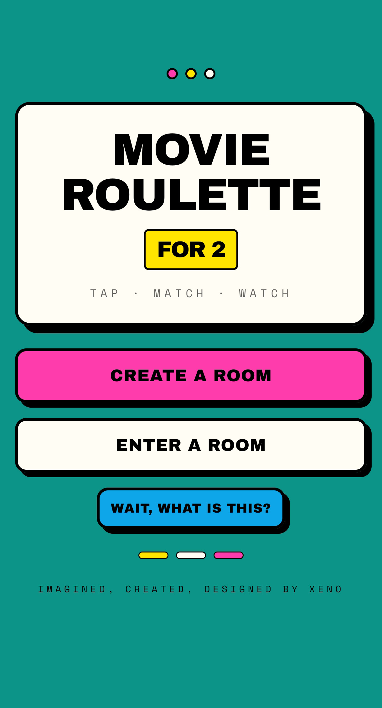
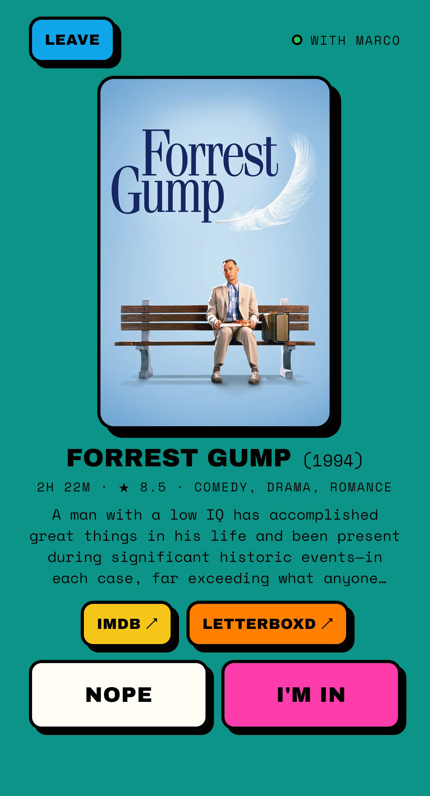
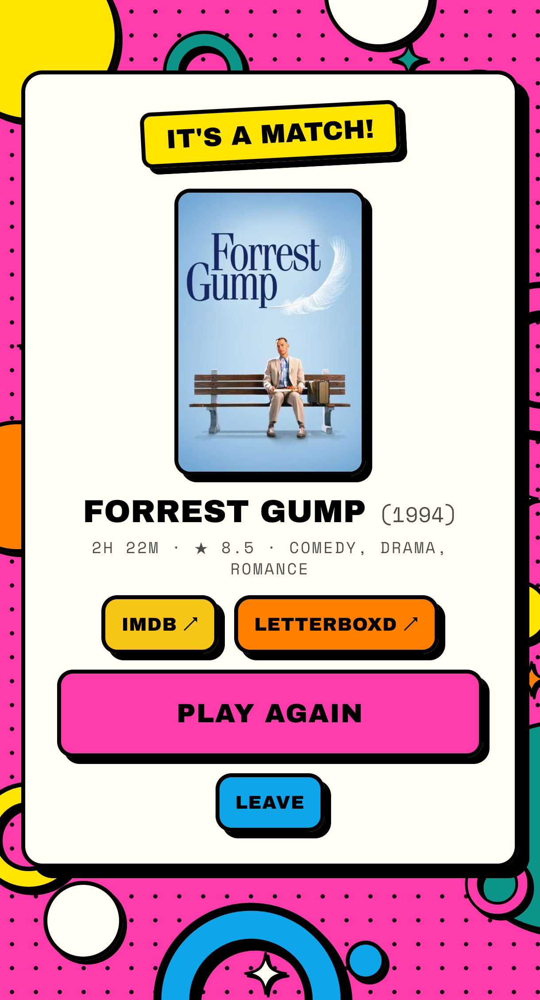

# Movie Roulette for 2

**Can't agree on what to watch? You — grab your phone. You — grab yours too. Now go through the same movies and tap Nope or I'm in. The first one you both say yes to is tonight's movie.**

Create a room, share the code or the invite link, and pick together in real time. Your picks stay private; only the match is revealed. No accounts, no sign-up, no ads.

**Live:** [whatshouldwewatch.site](https://whatshouldwewatch.site)

<p>
  
  
  
</p>

## Features

- **Real-time rooms for two**: create a room, then share the code, a link, or the native share sheet
- **Private picks**: neither player ever sees the other's choices, only the match
- **No waiting for each other**: a like counts whenever your partner reaches the same movie
- **Resilient sessions**: refresh, lose signal, or switch apps and you return to the same game; a seat is held for 90 seconds after disconnecting
- **Idle timeouts with a warning**: inactive seats are released after a "Popcorn break?" warning, so rooms never stay open forever
- **Play again or find a new partner** from the match screen
- **Explains itself**: invite links greet your friend with what's about to happen
- **Mobile-first**: thumb-reachable controls, haptics on Android, a match chime, and a safe-area aware layout
- **Accessible**: audited against WCAG 2.2 AA with a screen reader, keyboard, zoom, reduced motion, and forced colours (see the [accessibility report](docs/accessibility.md))

## Tech stack

| Area       | Choices                                                              |
| ---------- | -------------------------------------------------------------------- |
| Client     | React 19, TypeScript, Vite, React Router, Tailwind CSS 4             |
| Server     | Node.js 24, Express 5, Socket.IO 4, TypeScript                       |
| Shared     | A workspace package with the typed socket contract and constants     |
| Data       | [TMDB API](https://www.themoviedb.org/), called only from the server |
| Testing    | Vitest, React Testing Library                                        |
| Tooling    | npm workspaces, ESLint, Prettier, GitHub Actions                     |
| Production | Hetzner VPS, nginx, PM2, Let's Encrypt                               |

## Architecture

```
Browser ──HTTPS──► nginx ──┬── /           built client files (static)
                           └── /socket.io  ──► Node (127.0.0.1:3001) ──► TMDB
```

The repository is a monorepo with three workspaces:

```
client/   React app: routes, components, a game state reducer, socket context
server/   Express + Socket.IO: rooms, the matching engine, TMDB integration
shared/   Types and constants used by both sides
deploy/   nginx config and the deploy script
docs/     Accessibility audit and screenshots
```

### Key decisions

- **The server is the source of truth.** Rooms, decisions, and matches live on the server; clients only display state and send intents. The matching engine is a set of pure functions with unit tests.
- **One typed contract for every event.** `shared/` defines each Socket.IO event and acknowledgement once, so the client and server can't disagree about a payload.
- **Players are identified by a stable ID, not a socket.** A random session token, compared in constant time, lets a player resume their seat from a new connection after a refresh or network drop.
- **The client game state is a reducer.** Every transition is an explicit, tested action, which avoids stale closures and impossible states.
- **TMDB is treated as unreliable.** Requests retry with exponential backoff and jitter, go through a rate limiter, and share an in-memory details cache with in-flight deduplication.
- **Server-owned timers.** Grace periods and idle timeouts run on the server, which owns the memory they free; the client only shows the warning.
- **Secure by default in production.** Node listens on localhost only behind nginx, with HTTPS, HSTS, and a strict Content Security Policy.

### Shaped by real use

The app was tested on real Android phones, in Firefox and in Messenger's in-app browser, before launch. That testing found posters cropped on phones and sessions lost when Android closed a background tab, and both were fixed.

After launch, the first person to open the live link asked: _"yeah but what does the app do?"_ The explanation had been hidden behind a "How it works" button. Now the home screen's button asks the visitor's own question — **Wait, what is this?** — invite links explain themselves on the Join screen, and the share message reads as a personal invitation.

## Getting started

**Requirements:** Node.js 24 (pinned in `.nvmrc`) and a free [TMDB API key](https://www.themoviedb.org/settings/api).

```bash
git clone https://github.com/xenkou90/movie-roulette-for-2-v2.git
cd movie-roulette-for-2-v2
nvm use
npm ci
cp server/.env.example server/.env
cp client/.env.example client/.env
```

Add your TMDB key to `server/.env`, then run the server and the client in two terminals:

```bash
npm run dev:server
npm run dev:client
```

Open [http://localhost:5173](http://localhost:5173) in two browsers, or in a normal and a private window, to play both sides.

### Scripts

| Command                | What it does                                                   |
| ---------------------- | -------------------------------------------------------------- |
| `npm run dev:server`   | Server with live reload on port 3001                           |
| `npm run dev:client`   | Vite dev server on port 5173, proxying Socket.IO to the server |
| `npm test`             | All unit and component tests                                   |
| `npm run lint`         | ESLint across the monorepo                                     |
| `npm run typecheck`    | TypeScript in every workspace                                  |
| `npm run format:check` | Prettier                                                       |
| `npm run build`        | Production builds of the client and the server                 |
| `npm start`            | Runs the built server                                          |

## Testing

Tests cover the matching engine, retries, and rate limiting on the server, and the game reducer, session storage, formatting, links, the Join screen, and UI components on the client. CI runs formatting, linting, type checking, tests, and both production builds on every pull request.

## Deployment

Production runs on a single VPS: nginx serves the client and proxies Socket.IO to Node, which PM2 keeps running. After merging to `main`, running [`deploy/deploy.sh`](deploy/deploy.sh) on the server pulls, installs, builds, reloads, and checks health in one step. The nginx configuration is versioned in [`deploy/nginx/`](deploy/nginx/).

## Known limitations

- Rooms live in memory, so a server restart ends active games.
- One seat per browser: opening the app in a second tab of the same browser takes over the seat.
- Room codes have about 100,000 combinations; they're short-lived and not a security boundary.
- Vibration isn't available on iPhone.

## Credits

Imagined, created and designed by Xeno.

This product uses the TMDB API but is not endorsed or certified by TMDB. Movie data and posters are provided by [The Movie Database](https://www.themoviedb.org/).
